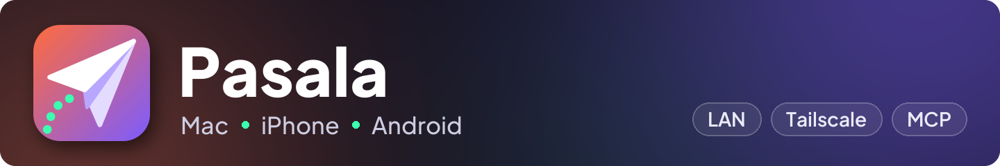
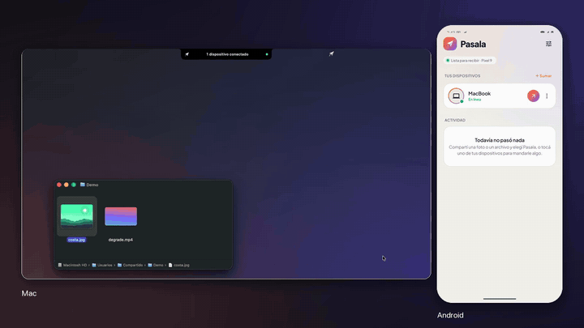

<p align="center"></p>

<p align="center"><a href="README.md">Español</a> · <a href="README.en.md">English</a> · <b>Deutsch</b></p>

<p align="center">
Schick Dateien zwischen deinem Mac, deinem iPhone und deinem Android hin und her, in jede Richtung.<br>
Über das WLAN zu Hause oder über Tailscale. Keine Cloud, keine Konten, keine Telemetrie.
</p>

<p align="center"></p>
<p align="center"><a href="docs/media/pasala-demo.mp4">Video ansehen (MP4)</a></p>

## Was es kann

Die Geräte werden einmal per QR-Code gekoppelt; danach kann jedes jedem etwas schicken, im Heimnetz oder
von unterwegs über [Tailscale](https://tailscale.com). Die Apps gibt es auf Spanisch und Englisch, je nach Systemsprache;
die Namen der Menüpunkte unten sind die englischen.

**Mac**: eine Menüleisten-App mit einer Insel oben in der Bildschirmmitte (im Notch-Stil).
- Mit der Maus darüber siehst du deine Geräte und was zuletzt angekommen ist; Doppelklick öffnet das Fenster.
- Wenn Dateien ankommen, klappt die Insel auf und die Vorschaubilder fallen mit ihrem Fortschritt hinein.
- Dateien auf die Insel ziehen und über einem Gerät loslassen, um sie zu schicken.
- Ein Fenster mit allem Empfangenen und Gesendeten, nach Tagen gruppiert.
- **Sammlungen**: benannte Ordner, die deine anderen Geräte beim Senden auswählen können.
- **Text**: Text in einer beliebigen App markieren, Rechtsklick → *Send with Pasala*; oder Rechtsklick auf die Insel →
  *Send Copied Text*. Ankommender Text liegt zum Kopieren bereit, ohne deine Zwischenablage zu überschreiben.
- Die Insel gedrückt halten und auf einen anderen Bildschirm ziehen (sie merkt sich, wo du sie gelassen hast).
- Symbol in der Menüleiste: ein Klick öffnet das Menü, ein Doppelklick das Fenster; *Show Notch* blendet die Insel aus oder ein.
- Im Finder: Rechtsklick auf Dateien → *Send with Pasala* und das Gerät auswählen.

**Android**: erscheint unter *Teilen* für jede Datei.
- Ziel auswählen (und eine Sammlung, falls das Ziel welche hat), fertig.
- Text: *Send with Pasala* im Menü beim Markieren von Text, oder *Send copied text* in der App oder als Kachel in den Schnelleinstellungen.
- Empfängt im Hintergrund; Fotos und Videos erscheinen in der Galerie (`Pictures/Pasala`, `Movies/Pasala`).
- Koppelt sich mit einem anderen Android oder mit dem Mac: Eines der beiden Geräte scannt das andere.

**iPhone**: erscheint unter *Teilen*, genau wie bei Android.
- Ziel und Sammlung auswählen und los; Fotos, Videos oder Dateien lassen sich auch in der App auswählen.
- Empfängt, solange Pasala geöffnet ist; Empfangenes landet in Dateien › Pasala und auf Wunsch in Fotos.
- Zum Koppeln den Code mit der iPhone-Kamera scannen oder den eigenen zeigen.

**Agenten (MCP)**: Mit `pasala-mcp` kann Claude oder ein anderer Agent den Index des Empfangenen abfragen
(was angekommen ist, von wem, wann und wo es gespeichert wurde), ein Bild ansehen und Dateien an ein Gerät schicken.

## Aufbau

```
docs/PROTOCOL.md     Vertrag zwischen den Apps (QR, Routen, Header, Sammlungen)
apple/               Swift-Paket: gemeinsamer Kern + Mac-App + pasala-mcp
apple/iOS/           iPhone-App + Teilen-Erweiterung (gleicher Kern)
android/             Android-App (Kotlin + Jetpack Compose)
docs/engineering/    Systemübersicht, Entscheidungen, Tests, Änderungsablauf (auf Spanisch)
```

## Mac

Benötigt macOS 14+ und Xcode (oder die Command Line Tools mit Swift 6).

```bash
cd apple && ./build.sh
cp -R build/Pasala.app /Applications/ && open /Applications/Pasala.app
```

Die App ist ad hoc signiert: Beim ersten Start fragt macOS, ob sie das lokale Netzwerk nutzen darf (nötig, um
über WLAN zu senden). Empfangenes landet in `~/Downloads/Pasala` (änderbar in den Einstellungen, pro Gerät oder pro Sammlung).

### MCP

```bash
claude mcp add --scope user pasala /Applications/Pasala.app/Contents/MacOS/pasala-mcp
```

| Werkzeug | was es tut |
|---|---|
| `pasala_new_files` | Empfangenes, das der Agent noch nicht gesehen hat (und markiert es als gesehen) |
| `pasala_list_files` | Liste mit Filtern: `direction`, `since`, `device`, `kind`, `collection`, `only_new` |
| `pasala_search` | Suche nach Namen |
| `pasala_get_file` | Metadaten; mit `include_content` liefert es das Bild oder den Text |
| `pasala_mark_seen` | markiert als gesehen |
| `pasala_devices` | Geräte, ob sie online sind, Sammlungen und Empfangsordner |
| `pasala_send_text` | schickt Text zum Kopieren an ein anderes Gerät |
| `pasala_send` | schickt Dateien vom Mac an ein Gerät (optional in eine seiner Sammlungen) |
| `pasala_pair` | koppelt über den `pasala://pair?d=…`-Link eines anderen Geräts |

## iPhone

Benötigt Xcode 16+ (iOS 17+).

```bash
open apple/iOS/Pasala.xcodeproj
```

Um sie auf einem iPhone zu installieren, in beiden Targets (`Pasala` und `PasalaShare`) dein Signing-Team auswählen;
beide nutzen die App Group `group.com.tecnomanu.pasala`, um die gekoppelten Geräte zu teilen.
Das iPhone empfängt nur, solange die App geöffnet ist (iOS erlaubt keine Server im Hintergrund).

## Android

Benötigt JDK 21 und das Android SDK (API 36).

```bash
cd android
JAVA_HOME=$(/usr/libexec/java_home -v 21) ./gradlew assembleDebug
adb install -r app/build/outputs/apk/debug/app-debug.apk
```

## Sicherheit

- Nur Geräte, die per QR-Code gekoppelt wurden, sprechen miteinander (Einmalcode, läuft nach 5 Minuten ab);
  jedes Paar teilt sein eigenes Geheimnis.
- Über Tailscale ist der Verkehr verschlüsselt. Im lokalen Netz ist er (noch) unverschlüsselt: nur in Netzen nutzen, denen du vertraust.
- Die App schickt nichts an externe Dienste.

## Lizenz

[MIT](LICENSE). Die Schrift Plus Jakarta Sans steht unter der
[SIL Open Font License](android/third_party/plus-jakarta-sans/OFL.txt).
