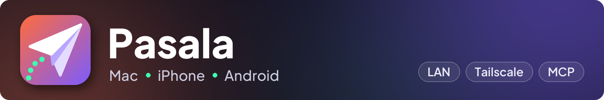
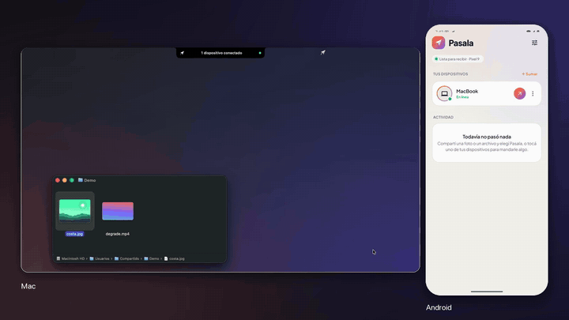

<p align="center"></p>

<p align="center"><a href="README.md">Español</a> · <b>English</b> · <a href="README.de.md">Deutsch</a></p>

<p align="center">
Send files between your own Mac, iPhone and Android, in any direction.<br>
Over your home Wi-Fi or over Tailscale. No cloud, no accounts, no telemetry.
</p>

<p align="center"></p>
<p align="center"><a href="docs/media/pasala-demo.mp4">Watch the video (MP4)</a></p>

## What it does

Devices pair once by scanning a QR code; after that any of them can send to any other, on your home network
or from outside over [Tailscale](https://tailscale.com). The apps are in Spanish or English, following the system language.

**Mac**: a menu bar app with an island at the top center of the screen (notch style).
- Hover it to see your devices and what arrived last; double-click opens the window.
- When files arrive, the island expands and the thumbnails drop in with their progress.
- Drag files onto the island and drop them on a device to send them.
- A window with everything received and sent, grouped by day.
- **Collections**: named folders your other devices can pick when they send you something.
- **Text**: select text in any app, right-click → *Send with Pasala*; or right-click the island →
  *Send Copied Text*. Text that arrives is ready to copy, without overwriting your clipboard.
- Press and hold the island, then drag it to another screen (it remembers where you left it).
- Menu bar icon: one click opens the menu, a double click opens the window; *Show Notch* hides or shows the island.
- In Finder: right-click files → *Send with Pasala* and pick the device.

**Android**: shows up in *Share* for any file.
- Pick a device (and a collection, if that device has any) and that's it.
- Text: *Send with Pasala* in the menu when you select text, or *Send copied text* from the app or the Quick Settings tile.
- Receives in the background; photos and videos show up in the gallery (`Pictures/Pasala`, `Movies/Pasala`).
- Pairs with another Android or with the Mac: either one scans the other.

**iPhone**: shows up in *Share*, same as on Android.
- Pick a device and a collection and it goes; you can also pick photos, videos or files from the app.
- Receives while Pasala is open; what arrives lands in Files › Pasala and, if you want, in Photos.
- To pair, scan the code with the iPhone's camera or show yours.

**Agents (MCP)**: `pasala-mcp` lets Claude or another agent query the index of received files
(what arrived, from whom, when, where it was saved), look at an image and send files to a device.

## Layout

```
docs/PROTOCOL.md     contract between the apps (QR, routes, headers, collections)
apple/               Swift package: shared core + Mac app + pasala-mcp
apple/iOS/           iPhone app + Share extension (same core)
android/             Android app (Kotlin + Jetpack Compose)
docs/engineering/    system map, decisions, testing, change workflow (in Spanish)
```

## Mac

Requires macOS 14+ and Xcode (or the Command Line Tools with Swift 6).

```bash
cd apple && ./build.sh
cp -R build/Pasala.app /Applications/ && open /Applications/Pasala.app
```

The app is signed ad hoc: the first time, macOS asks whether it may use the local network (needed to
send over Wi-Fi). Received files go to `~/Downloads/Pasala` (change it in Settings, per device or per collection).

### MCP

```bash
claude mcp add --scope user pasala /Applications/Pasala.app/Contents/MacOS/pasala-mcp
```

| tool | what it does |
|---|---|
| `pasala_new_files` | received files the agent hasn't seen yet (and marks them seen) |
| `pasala_list_files` | list with filters: `direction`, `since`, `device`, `kind`, `collection`, `only_new` |
| `pasala_search` | search by name |
| `pasala_get_file` | metadata; with `include_content` it returns the image or the text |
| `pasala_mark_seen` | marks files as seen |
| `pasala_devices` | devices, whether they're online, collections and the inbox folder |
| `pasala_send_text` | sends text to copy on another device |
| `pasala_send` | sends files from the Mac to a device (optionally to one of its collections) |
| `pasala_pair` | pairs using another device's `pasala://pair?d=…` link |

## iPhone

Requires Xcode 16+ (iOS 17+).

```bash
open apple/iOS/Pasala.xcodeproj
```

To install it on an iPhone, choose your signing team in both targets (`Pasala` and `PasalaShare`);
both use the App Group `group.com.tecnomanu.pasala` to share the paired devices.
The iPhone receives only while the app is open (iOS doesn't allow background servers).

## Android

Requires JDK 21 and the Android SDK (API 36).

```bash
cd android
JAVA_HOME=$(/usr/libexec/java_home -v 21) ./gradlew assembleDebug
adb install -r app/build/outputs/apk/debug/app-debug.apk
```

## Security

- Only devices that paired by scanning the QR code talk to each other (one-time code, expires in 5 minutes);
  each pair shares its own secret.
- Over Tailscale the traffic is encrypted. On the local network it is not encrypted (yet): use it on networks you trust.
- The app sends nothing to any outside service.

## License

[MIT](LICENSE). The Plus Jakarta Sans font is distributed under the
[SIL Open Font License](android/third_party/plus-jakarta-sans/OFL.txt).
