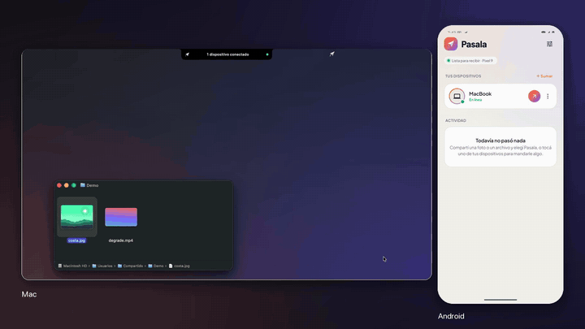

<p align="center"></p>

<p align="center"><b>Español</b> · <a href="README.en.md">English</a> · <a href="README.de.md">Deutsch</a></p>

<p align="center">
Pasá archivos entre tu Mac, tu iPhone, tu Android y tus compus con Windows o Linux, en cualquier dirección.<br>
Por el Wi-Fi de casa o por Tailscale. Sin nube, sin cuentas, sin telemetría.
</p>

<p align="center"></p>
<p align="center"><a href="docs/media/pasala-demo.mp4">Ver el video (MP4)</a></p>

> [!TIP]
> **¿Sos un agente de IA (Claude, Codex, Cursor…)?** Leé [`AGENT_INSTALL.md`](AGENT_INSTALL.md): qué preguntarle a
> tu usuario y cómo instalar Pasala en su computadora (macOS, Windows, Linux) y en sus celulares (Android por USB
> o sin cable, iPhone con Xcode), vincularlos y conectarte por MCP.

## Qué hace

Los dispositivos se vinculan una vez escaneando un QR y después cualquiera le manda a cualquiera, por la red
de casa o por [Tailscale](https://tailscale.com) desde afuera. Las apps están en español o inglés según el idioma del sistema.

**Mac**: app de barra de menú con una isla arriba al centro (estilo notch).
- Pasás el mouse y ves tus dispositivos y lo último que llegó; doble clic abre la ventana.
- Cuando llegan archivos, la isla se despliega y las miniaturas caen adentro con su progreso.
- Arrastrás archivos hacia la isla y los soltás sobre un dispositivo para mandarlos.
- Ventana con el mazo de lo recibido y lo enviado, agrupado por día.
- **Colecciones**: carpetas con nombre que tus otros dispositivos pueden elegir al mandarte algo.
- **Texto**: seleccioná texto en cualquier app, clic derecho → *Pasar con Pasala*; o clic derecho en la isla →
  *Enviar texto copiado*. Lo que llega como texto queda listo para copiar, sin pisar tu portapapeles.
- Mantené apretada la isla y arrastrala para llevarla a otra pantalla (se acuerda dónde la dejaste).
- Ícono de la barra: un clic abre el menú, doble clic abre la ventana; *Mostrar notch* oculta o muestra la isla.
- En Finder: clic derecho sobre archivos → *Enviar con Pasala* y elegís a qué dispositivo.

**Android**: aparece en *Compartir* para cualquier archivo.
- Elegís un destino (y una colección si ese destino tiene) y listo.
- Texto: *Pasar con Pasala* en el menú al seleccionar texto, o *Enviar lo copiado* desde la app o el panel de ajustes rápidos.
- Recibe en segundo plano; fotos y videos aparecen en la galería (`Pictures/Pasala`, `Movies/Pasala`).
- Vincula con otro Android o con la Mac: cualquiera de los dos escanea al otro.

**iPhone**: aparece en *Compartir* igual que en Android.
- Elegís destino y colección y se manda; también podés elegir fotos, videos o archivos desde la app.
- Recibe mientras Pasala está abierta; lo que llega queda en Archivos › Pasala y, si querés, en Fotos.
- Para vincular, escaneás el código con la cámara del iPhone o mostrás el tuyo.

**Windows y Linux**: la misma idea que la Mac, en la bandeja del sistema.
- Isla arriba al centro: dice cuántos dispositivos están conectados o qué acaba de llegar; al pasar el mouse muestra
  tus dispositivos, lo último que llegó y los botones. Soltás archivos encima para mandarlos; mantenela apretada y
  arrastrala para llevarla a otra pantalla. Se puede ocultar.
- Menú de la bandeja: enviar archivos, enviar el texto copiado, enviar a un dispositivo, abrir la carpeta de recibidos,
  sumar dispositivo, ajustes.
- **Ctrl+Alt+P** manda el texto que copiaste, desde cualquier app. Lo que llega como texto queda listo para copiar.
- Windows: clic derecho sobre archivos → *Enviar a › Pasala*. Linux: *Enviar a* en Thunar, *Scripts* en Nautilus,
  acciones en Nemo y Dolphin.
- Lo recibido va a `Descargas/Pasala`; también tiene colecciones y "preguntar antes de recibir".

**Agentes (MCP)**: `pasala-mcp` (Mac) y `Pasala --mcp` (Windows/Linux) dejan que Claude u otro agente consulte el índice de lo recibido
(qué llegó, de quién, cuándo, dónde quedó), vea una imagen y mande archivos a un dispositivo.

## Estructura

```
docs/PROTOCOL.md     contrato entre apps (QR, rutas, cabeceras, colecciones)
apple/               paquete Swift: núcleo compartido + app de Mac + pasala-mcp
apple/iOS/           app de iPhone + extensión de Compartir (usa el mismo núcleo)
kotlin/shared/       núcleo Kotlin del protocolo, compartido por Android y escritorio
android/             app Android (Kotlin + Jetpack Compose)
desktop/             app de Windows y Linux (Kotlin + Compose Desktop) + MCP
docs/engineering/    mapa del sistema, decisiones, pruebas, flujo de cambios
```

## Mac

Requiere macOS 14+ y Xcode (o las Command Line Tools con Swift 6).

```bash
cd apple && ./build.sh
cp -R build/Pasala.app /Applications/ && open /Applications/Pasala.app
```

La app se firma ad hoc: la primera vez macOS pregunta si puede usar la red local (hace falta para
mandar por Wi-Fi). Lo recibido va a `~/Downloads/Pasala` (se cambia en Ajustes, por dispositivo o por colección).

### MCP

```bash
claude mcp add --scope user pasala /Applications/Pasala.app/Contents/MacOS/pasala-mcp
```

| herramienta | qué hace |
|---|---|
| `pasala_new_files` | lo recibido que el agente todavía no vio (y lo marca visto) |
| `pasala_list_files` | lista con filtros: `direction`, `since`, `device`, `kind`, `collection`, `only_new` |
| `pasala_search` | busca por nombre |
| `pasala_get_file` | metadatos; con `include_content` devuelve la imagen o el texto |
| `pasala_mark_seen` | marca como vistos |
| `pasala_devices` | dispositivos, si están conectados, colecciones y carpeta de recibidos |
| `pasala_send_text` | manda un texto para copiar en otro dispositivo |
| `pasala_send` | manda archivos de la Mac a un dispositivo (opcional: a una de sus colecciones) |
| `pasala_pair` | vincula con el link `pasala://pair?d=…` de otro dispositivo |

## iPhone

Requiere Xcode 16+ (iOS 17+).

```bash
open apple/iOS/Pasala.xcodeproj
```

Para instalarla en un iPhone, elegí tu equipo de firma en los dos targets (`Pasala` y `PasalaShare`);
el App Group `group.com.tecnomanu.pasala` lo usan los dos para compartir los dispositivos vinculados.
El iPhone recibe solo con la app abierta (iOS no deja servidores en segundo plano).

## Android

Requiere JDK 21 y el Android SDK (API 36).

```bash
cd android
JAVA_HOME=$(/usr/libexec/java_home -v 21) ./gradlew assembleDebug
adb install -r app/build/outputs/apk/debug/app-debug.apk
```

## Windows y Linux

Instaladores: `.msi` (Windows 10/11), `.deb` (Ubuntu/Debian) y AppImage (cualquier Linux x64). Traen su propio Java.
Para armarlos hace falta JDK 17+ en ese mismo sistema:

```bash
cd desktop
./gradlew :app:packageDeb :app:packageAppImage && tools/make-appimage.sh   # Linux
gradlew.bat :app:packageMsi                                                # Windows
```

En Linux la transparencia de la isla necesita un escritorio con compositor, y el atajo global funciona en X11
(en Wayland asociá un atajo del sistema a `pasala --send-text`).

## Seguridad

- Solo hablan dispositivos que se vincularon escaneando el QR (código de un solo uso, vence en 5 minutos);
  cada par comparte un secreto propio.
- Por Tailscale el tráfico va cifrado. En la red local va sin cifrar (por ahora): usalo en redes en las que confiás.
- La app no manda nada a ningún servicio externo.

## Licencia

[MIT](LICENSE). La fuente Plus Jakarta Sans se distribuye bajo la
[SIL Open Font License](android/third_party/plus-jakarta-sans/OFL.txt) (copia también en `desktop/third_party/`).
